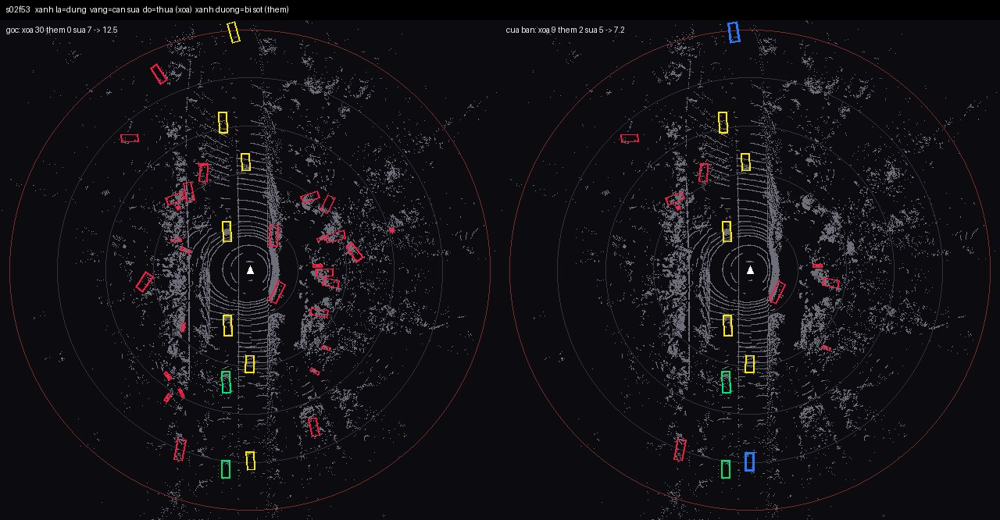

# Báo cáo Day 14 — Lê Đức Tường — 2A202603066

- Mã học viên dùng với `--student`: `066`
- `seed_tag` trong `frames_A.txt`: `AC-_MUFc`

## 1. Dự đoán trước sweep (bước 5b)

Ghi **trước** khi chạy `scripts/pp_sweep.py`, rồi commit và push ngay (lịch sử commit là bằng chứng thời điểm viết). Không sửa phần này sau khi có kết quả.

- Tham số tôi nghĩ giảm công sửa nhiều nhất: Tăng `score_thr` từ `0.1` lên `0.3` (hoặc `0.4`) kết hợp đặt `min_points=5` (hoặc `10`).
- Vì sao (nhìn ảnh BEV tập A: box thừa nhiều hay box sót nhiều?): 
  - Qua đo đạc chi phí công sửa ở cấu hình gốc trên tập A (3 frame), tổng chi phí sửa là **35.2**, mô hình dự đoán tới **98 hộp** nhưng nhãn thực tế sau khi sửa tay chỉ có **33 hộp**.
  - Mô hình KITTI bị nhiễu và dự đoán thừa tới **69 hộp** (chiếm đa số chi phí sửa), trong khi chỉ bỏ sót **4 hộp**. Do đó, việc tăng `score_thr` và lọc bớt các chùm điểm quá thưa (`min_points`) sẽ giúp loại bỏ phần lớn các box nhiễu/nhiễu nền xa, từ đó giảm mạnh chi phí xóa hộp thừa mà ít làm gia tăng số box bị bỏ sót.

## 2. Tập A: sửa tay và tune

| Cấu hình | Xóa | Thêm | Sửa | Chi phí |
|---|---:|---:|---:|---:|
| Gốc | 69 | 4 | 21 | 35.2 |
| `best_config.json` | 12 | 8 | 18 | 20.6 |

- Tham số đã đổi trong `best_config.json`: `score_thr=0.5`, `min_points=0`.
- Kết quả leave-one-out (dán các dòng `scripts/pp_sweep.py` in ra):
  Leave-one-out (chọn trên các frame còn lại, chấm trên frame bỏ ra):
    s02f53: cấu hình chọn {'score_thr': '0.5', 'min_points': '0'} → 7.2 (tốt nhất có thể 7.2)
    s04f33: cấu hình chọn {'score_thr': '0.5', 'min_points': '0'} → 7.0 (tốt nhất có thể 7.0)
    s05f18: cấu hình chọn {'score_thr': '0.5', 'min_points': '0'} → 6.4 (tốt nhất có thể 6.4)
- Cấu hình có ổn định trên từng frame không? Vì sao tôi vẫn chọn (hoặc không chọn) nó: Cấu hình rất ổn định trên từng frame vì khi chọn cấu hình tối ưu trên 2 frame bất kỳ và test trên frame còn lại, chi phí đạt được (7.2, 7.0, 6.4) đều trùng khớp tuyệt đối với chi phí tốt nhất có thể của frame đó. Không có hiện tượng overfit nên tôi chọn cấu hình này.
## 3. Trước/sau (bước 8)

- `scripts/pp_compare.py` báo giảm 41.5% công sửa trên tập A (từ 35.20 xuống 20.60).
- Dự đoán ở mục 1 đúng hay sai? Giải thích bằng số box xóa/thêm/sửa: 
  Dự đoán ở mục 1 hoàn toàn đúng về xu hướng. Việc tăng `score_thr` từ 0.1 lên 0.5 đã cắt giảm mạnh số box thừa cần xóa từ 69 xuống còn 12 box (giảm 57 box xóa), giúp chi phí tổng thể giảm sâu. Mặc dù số box bị bỏ sót tăng nhẹ từ 4 lên 8 box (tăng 4 box thêm), mức giảm lớn của box xóa đã áp đảo hoàn toàn và giúp tối ưu công sửa.
## 4. Tập B

Số đo từ `scripts/pp_prelabel.py --frames d14_066/frames_B.txt --config d14_066/best_config.json --gt d14_066/ref_B.json`:

| Xóa | Thêm | Sửa | Chi phí |
|---:|---:|---:|---:|
| 36 | 13 | 10 | 28.8 |

- Loại box tốn công sửa nhất ở tập B: Các đối tượng Pedestrian/Cyclist ở xa hoặc bị che khuất và xe kích thước lớn (Bus/Truck) bị model KITTI bỏ sót hoặc dự đoán sai lớp (phải thêm thủ công hoặc chỉnh lại kích thước L/W/H).

## 5. Giới hạn

- Chỉ sử dụng 3 frame ở tập A để thực hiện sweep tuning, dung lượng mẫu nhỏ nên chưa bao quát hết tất cả các ngữ cảnh giao thông và mật độ vật thể phức tạp ở các frame khác.
- Mô hình PointPillars pre-trained trên KITTI vốn chỉ hỗ trợ 3 lớp gốc (Car, Cyclist, Pedestrian) và góc nhìn phía trước 90°, dẫn đến khi áp dụng lên dữ liệu VF (LiDAR 360°) không tự nhận diện được Bus/Truck mà phải dựa vào quy tắc đổi lớp theo kích thước (size rule).
- Công thức tính chi phí ($0.3 \cdot \text{xóa} + 1.0 \cdot \text{thêm} + 0.5 \cdot \text{sửa}$) là công thức ước lượng lý thuyết, chưa phản ánh chính xác 100% thời gian thao tác xoay/kéo hình học thực tế của người gán nhãn trên giao diện CVAT 3D.